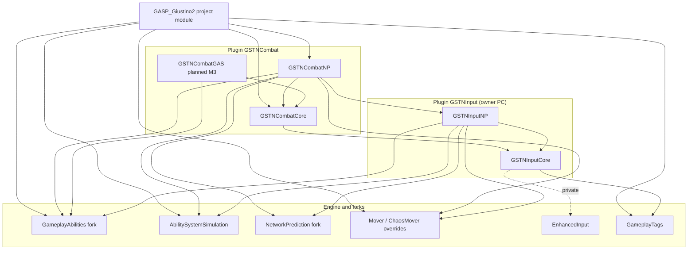

# Modularity and gameplay tags

Status: **Proposal** (except sections marked *Current state*, which describe the repository as surveyed on 2026-10-21).
Scope: how the project is split into plugins, which dependencies are allowed, how gameplay tags are owned and named,
and how this is enforced. Owner requirements, verbatim in spirit:

- Modularity and the split into plugins is fundamental: every plugin must be workable, buildable and testable alone.
- Gameplay tags are of fundamental importance: in a project this size they are the vocabulary the plugins share.
- The target is modularity comparable to Lyra or Fortnite.
- Epic's C++ coding standard; every plugin has human-readable docs.
- Most gameplay logic can be extended or changed by designers, easily, in Blueprint (2026-10-22, §3.8).
- Extreme modularity means content can be replaced as needed (2026-10-22, §3.9).

Owner direction that applies here: [game-design-direction.md](game-design-direction.md) (§6b listen server, §1 parts).

Related: [combat.md](combat.md) §3 (modules), §9 (command tags), §16 (project integration); [input.md](input.md) §2, §3,
§8; [gas-npp.md](gas-npp.md); milestone specs `combat-m5-editor.md`, `combat-m6-defence-links.md`,
`combat-m7-piggyback.md`, `combat-m8-minions.md`, [combat-parts.md](combat-parts.md) (M4b; each has a "Plugin and module boundaries" or tags section that this
document consolidates), and [many-enemies-replication.md](many-enemies-replication.md) §3.5, §4 (the platform plugins).

Notation: *Decision* = already decided in another document. *Proposal* = this document's suggestion, to be confirmed
by the owner (open questions in [open-questions-m4-m10.md](open-questions-m4-m10.md)). *Unsure* = I could not verify it against engine or
Lyra source in this session.

---

## 1. Goals and the reference model

### 1.1 Goals

1. **One plugin, one job.** A plugin can be opened, built, tested and shipped without the plugins that sit "above" it.
2. **Dependencies point down only.** Foundation plugins know nothing about gameplay; gameplay plugins know nothing
   about optional features; features know nothing about each other; the project module is glue.
3. **Features are switchable.** Piggyback, minions, held objects, a game mode can be added or removed without editing
   another plugin's code (data and tags change, source does not).
4. **Tags are the contract.** Plugins talk to each other through tags and small interfaces, not through includes.
5. **Rules are checked by machines**, not by memory: a script on `.Build.cs` files and a tag validator (section 6).
6. **Every plugin is reusable on its own in an independent project** (owner, 2026-10-22: "cerca di limitare il coupling dei
   plugins. Vorrei che siano utilizzabili a parte da altri progetti indipendenti"). Coupling between plugins is kept to the
   minimum; the rules are in section 3.7.
7. **Designers extend gameplay in Blueprint** (owner, 2026-10-22: "la maggior parte delle logiche gameplay devono poter essere
   estese o modificate dal designer in modo agevole tramite BP"). C++ owns the frame, the network model and the hot loops;
   designers own behaviour through data and Blueprint. Rules in section 3.8.
8. **Content is replaceable** (owner, 2026-10-22: "La modularità estrema deve permettere di rimpiazzare contenuti a seconda delle
   esigenze"). A kit, weapon, special, enemy, cue, UI piece or rule set is swapped by changing data, never code. Rules in
   section 3.9.

### 1.2 What Lyra and Fortnite do (the pattern to borrow)

Lyra (the UE sample) is built on a small set of engine features. Summary, with the names to look up in engine and Lyra
source. Anything marked *Unsure* should be checked before relying on it.

| Concept | What it is | Lyra usage |
|---|---|---|
| **Game Feature plugin** | A plugin with a `.uplugin` flagged as a game feature (`GameFeatureData` asset named after the plugin, `"ExplicitlyLoaded": true`, `"BuiltInInitialFeatureState"`). Loaded and activated at runtime through the `GameFeatures` subsystem (`UGameFeaturesSubsystem`): states Registered, Loaded, Active. Can contain content and optionally code modules. | Shooter core, top-down arena, weapons per mode ("ShooterCore", "ShooterMaps", "TopDownArena") are separate game feature plugins under `Plugins/GameFeatures/`. |
| **`UGameFeatureData` + `UGameFeatureAction`** | The data asset lists actions executed on activation, undone on deactivation. Engine actions (GameFeatures / ModularGameplay plugins): `AddComponents` (`UGameFeatureAction_AddComponents`: add a component class to actors of a given class when they exist or spawn), `AddGameplayCuePath`, `AddDataRegistry`, `AddDataAsset`, `AddWorldPartitionContent`. | Lyra adds its own actions in the `LyraGame` module: `AddAbilities` (grant `ULyraAbilitySet`s and attribute sets to actors of a class), `AddInputContextMapping`, `AddInputBinding` (an input config), `AddWidgets` (UI extension points and layers), `AddSpawningActions`-style helpers. *Unsure*: exact class names for the Lyra-only actions (`UGameFeatureAction_AddAbilities`, `..._AddInputContextMapping`, `..._AddInputBinding`, `..._AddWidgets`). |
| **Modular Gameplay** | Plugin `ModularGameplay` / `ModularGameplayActors`: `UGameFrameworkComponentManager` (a game-instance subsystem) lets any code say "when an actor of class X exists (or `AddReceiver` is called for it), add component Y / call this handler". Receivers register with `AddReceiver(Actor)` in `PreInitializeComponents` (the `AModularCharacter`, `AModularPlayerState`, ... base classes do this). Extension handlers are `FExtensionHandlerDelegate` keyed by event names (`NAME_ReceiverAdded`, `NAME_ReceiverRemoved`, custom events through `SendGameFrameworkComponentExtensionEvent`). | Game feature actions use it to add components to `ALyraCharacter` etc. without the character class naming them. |
| **Init-state chain** | `IGameFrameworkInitStateInterface` + `UGameFrameworkComponentManager::RegisterInitState` / `ChangeFeatureInitState`. Each feature on an actor (feature name `FName`) advances through registered states (`Spawned` → `DataAvailable` → `DataInitialized` → `GameplayReady`) only when `CanChangeInitState` says its dependencies are ready; `ContinueInitStateChain()` is called when something changes. | `ULyraPawnExtensionComponent` is the hub: it holds the pawn data (`ULyraPawnData`), owns the ASC link (`InitializeAbilitySystem`) and gates other features (`ULyraHeroComponent`, `ULyraHealthComponent`) so they initialise in a defined order whatever the replication arrival order. |
| **Experience** | `ULyraExperienceDefinition` (a `UPrimaryDataAsset`): `DefaultPawnData`, list of game feature plugin names to activate, list of `ULyraExperienceActionSet`s, extra actions. `ULyraExperienceManagerComponent` (on `AGameState`) loads the experience asynchronously: asset bundles, then activates features, executes actions, then broadcasts `OnExperienceLoaded` at three priorities (high/normal/low). Game mode waits for it before spawning pawns. Selected from map settings, `ExperienceOverride` in the URL, or user-facing room settings. | A "mode" is an experience asset: it decides which features exist, not a game mode subclass. |
| **Pawn data** | `ULyraPawnData`: pawn class, default ability sets, tag relationship mapping, input config, camera mode. Assigned per experience, per player. | Replaces hard-wired Blueprint defaults on the pawn. |
| **Ability sets** | `ULyraAbilitySet`: granted abilities (class, level, **input tag**), granted effects, granted attribute sets; `GiveToAbilitySystem` returns a handle struct that `TakeFromAbilitySystem` undoes. | The unit by which a feature adds or removes abilities. |
| **Input configs mapped by tags** | `ULyraInputConfig`: arrays `{InputAction, InputTag}` for native (movement, look) and ability inputs. `ULyraInputComponent::BindAbilityActions` binds each tagged action to `ULyraAbilitySystemComponent::AbilityInputTagPressed/Released`; abilities declare a `InputTag` in their spec dynamic source tags. Mapping contexts are added by `AddInputContextMapping` actions. | Tags are the join between hardware (actions) and gameplay (abilities). |
| **Tag relationship mapping** | `ULyraAbilityTagRelationshipMapping`: per ability tag, "blocks / cancels / requires / blocked by" tag lists, applied by the ASC. | Rules between abilities are data keyed by tags, not code. |
| **UI extension points** | Plugin `UIExtension`: `UUIExtensionSubsystem`, widget `UUIExtensionPointWidget`; features register widgets for a **tag** (`UI.Extension...`-style point tags); game feature action `AddWidgets` pushes layouts (CommonUI primary game layout, layer tags such as `UI.Layer.Menu`, `UI.Layer.Game`). | A feature ships its HUD piece without the HUD knowing it. |
| **Gameplay Message Router** | Plugin `GameplayMessageRuntime`: `UGameplayMessageSubsystem::BroadcastMessage(Channel tag, Struct)` and `RegisterListener(Channel tag, ...)`. Typed structs (`FLyraVerbMessage` with a verb tag, instigator, target, magnitude), channels are tags such as `Lyra.AddNotification.Message`. | Decoupled events (damage, elimination, UI notifications) without direct references. *Unsure*: the channel tag names in current Lyra. |
| **Team and cheats subsystems, interaction, settings** | Separate modules/plugins (`LyraGame` itself is large: Lyra is not fully modular in code, mostly modular in *content and registration*). | Worth noting: the game module is still big. The modularity is in how things are *added*. |

Fortnite (public talks and UEFN documentation, *Unsure* on internal details) applies the same idea at larger scale: the
game is a base plus many Game Feature plugins composed by experience (island/mode) definitions; features add
components, abilities and UI by data; tags and message channels are the cross-feature language.

**What we take from this:** (a) a *registration* model (features add themselves to actors by data), (b) tags as the
only shared vocabulary, (c) data assets that list what a mode or character gets (pawn data, ability sets, kit,
loadout), (d) an experience that selects features per mode. **What we do not copy blindly:** Lyra's game module
holds a lot of code; here the split must be enforced in module dependencies, which Lyra does not do for its core.

### 1.3 Constraint specific to this project

Gameplay abilities and combat run **inside Network Prediction** (rollback, re-simulation). Anything that adds
simulation behaviour at runtime changes the sync/aux state layout and the order of simulation, and must therefore
be identical on server and clients at the moment the pawn starts simulating. Consequences:

- A feature that touches the simulation (adds a sync fragment, a tick extension, an ability) must be active before
  the pawn's first NP tick, and deactivating it mid-match is not supported (activate on experience load, deactivate
  on map change). This is the reason the proposal keeps *experience-level* activation, not per-frame toggling.
- `UGameFrameworkComponentManager` adding components to a pawn after `BeginPlay` is fine for presentation and UI
  components, risky for simulation components. Simulation components keep being added by data on the pawn
  Blueprint or by an ability-set-like asset applied before `BeginPlay`; see section 3.4.
- The `FSync*` / `FAux*` state types of a plugin that is not loaded must not appear in a state that a loaded plugin
  serialises: the combat spec already solves this with sync fragments (combat-m6 §1b: absent fragment = zero bytes).

---

## 2. Current state (*Current state*)

Surveyed: `CLAUDE.md`, `combat.md` §3/§9/§16, `input.md` §2/§3/§8, `.uproject`, every `.uplugin` and `*.Build.cs`
under `Source/` and `Plugins/GSTN*`, native and ini tag declarations.

**Caveat on the checkout.** The surveyed working tree (the GitHub version) contains `Plugins/GSTNCombat` only.
`CLAUDE.md` and `input.md` already describe `Plugins/GSTNInput` with `GSTNInputCore` and `GSTNInputNP`; the owner's
PC has it. The tables below show **both**: "in repo" is what I read, "on owner's PC" is what the coordinator reported.

### 2.1 Plugin and module map

| Plugin / folder | Module (type) | Exists | Declared dependencies (Build.cs) |
|---|---|---|---|
| `Plugins/GASNPP/` (`GameplayAbilities`, `AbilitySystemSimulation`, `NetworkPrediction`, `NetworkPredictionExtras`, `NetworkPredictionInsights`) | engine forks | in repo | engine-level; see `PATCHES.md`. Same plugin names as engine plugins, so they shadow them. |
| `Plugins/EngineOverrides/` (`Mover`, `ChaosMover`, `MoverExamples`, `SmartObjects`, `GameplayInteractions`, `GameplayTargetingSystem`, `AllToolsets`, `GASToolsets`) | engine overrides | in repo | engine-level |
| `Plugins/UE_MCP_Bridge` | editor tooling | in repo | not surveyed |
| `GSTNInput` | `GSTNInputCore` (Runtime) | owner's PC | Core, CoreUObject, Engine, GameplayTags, DeveloperSettings; private EnhancedInput (input.md §2) |
| `GSTNInput` | `GSTNInputNP` (Runtime) | owner's PC | GSTNInputCore, GameplayAbilities, AbilitySystemSimulation, NetworkPrediction, NetCore, Mover; private EnhancedInput |
| `GSTNCombat` | `GSTNCombatCore` (Runtime) | in repo | public Core, CoreUObject, Engine, GameplayTags, DeveloperSettings; private EnhancedInput. Target: + GSTNInputCore |
| `GSTNCombat` | `GSTNCombatNP` (Runtime) | in repo | public Core, CoreUObject, Engine, GameplayTags, GSTNCombatCore, GameplayAbilities, AbilitySystemSimulation, NetworkPrediction, NetCore, Mover; private EnhancedInput. Target: + GSTNInputNP |
| `GSTNCombat` | `GSTNCombatGAS` | planned (M3) | Core, GameplayAbilities, GameplayTasks (combat-m3 §), no NP, no Mover |
| `GSTNCombatEditor`, `GSTNCombatDebug` | each its own plugin and module: Editor / Runtime (no Shipping) | planned (M5 §3b; they are not modules of `GSTNCombat`) | `GSTNCombat`, `GSTNInput`, GameplayDebugger (Debug); the editor loads Debug dynamically, no link |
| `GSTNDefence` (`...Core`, `...GAS`, `...NP`), `GSTNLink` (same three) | Runtime | planned (M6 spec) | see combat-m6 §1b |
| `GSTNPiggyback` (`...Core`, `...Runtime`, `...Editor`, `...Tests`) | Runtime / Editor / Developer | planned (M7) | `GSTNLink` + `GSTNCombat` |
| `GSTNHeld` (`...Core`, `...GAS`, `...NP`, `...StockGAS`, `...Editor`) | Runtime / Editor | planned (M10) | `GSTNLink` + `GSTNCombat` |
| `GSTNMinion` (`...Core`, `...Runtime`, `...Mover`, `...Editor`) | Runtime / Editor | planned (M8; a separate plugin, never a module of `GSTNCombat`) | `GSTNCombat` (Core/GAS/NP), StateTree, Navigation |
| `GASP_Giustino2` (project) | `GASP_Giustino2` (Runtime) | in repo | public: Core, CoreUObject, Engine, InputCore, Mover, GameplayTags, NetCore, GameplayAbilities, AbilitySystemSimulation, **GSTNCombatNP, GSTNCombatCore**; private: GameplayTasks, NetworkPrediction, EnhancedInput, Json |

`GSTNCombat.uplugin` lists plugin dependencies GameplayAbilities, AbilitySystemSimulation, NetworkPrediction,
EnhancedInput, Mover. It has no `GSTNInput` entry in the repo copy (expected after the split). The `.uproject` enables
`GSTNCombat` explicitly and the engine plugins listed in its `Plugins` array (Mover, NetworkPrediction, GameplayAbilities,
EnhancedInput, ChaosMover, Niagara, PCG, ...).

### 2.2 Dependency graph



Reading the graph: the edges are acyclic and point down. The two problem edges are at the bottom: the project
module depends on **combat internals** (`GSTNCombatNP`, `GSTNCombatCore`) directly, and `GSTNCombatCore` is declared
"pure" but today carries `EnhancedInput` as a private dependency and the command/button tags that belong to input.

### 2.3 Tag inventory (native declarations found)

| Root | Tags | Declared in | Module | Owner (today) | Docs comment |
|---|---|---|---|---|---|
| `Ability.Movement.*` | `Jump`, `WallSlide` | `Source/.../GAS/GSTN_AbilityTags.h` | project | project | yes (`UE_DEFINE_GAMEPLAY_TAG_COMMENT`) |
| `State.Movement.*` | `WallSliding`, `WallSlideBlocked`, `JumpBlocked` | same | project | project | yes |
| `Test.Cooldown.*`, `Test.State.*` | `Dash`, `Buff`, `Dashing`, `Buffed` | `Public/GASNPPTest/GSTN_TestEffects.h` | project | test harness | **no** (plain `UE_DEFINE_GAMEPLAY_TAG`) and exported from the project's **public** header |
| `Command.*` | roots `Attack Strong Special Combo Super`, plus 12 variants (`Neutral`, `Directional`, `CrouchNeutral`, `CrouchDirectional`) and 4 `Combo.AttackSpecial.*` | `GSTNCombatCore/Public/Input/GSTN_CombatCommandTags.h` | combat core | combat (planned: root belongs to input) | yes |
| `Combat.Context.*` | `Grounded`, `Airborne`, `OnWall` | same file | combat core | combat; input.md §3 renames to `Input.Context.*` | yes |
| `Input.Combat.Button.*` | `Attack Strong Special Crouch Shield Jump` | `GSTN_CombatInputTags.h` | combat core | combat; input.md §3 renames to `Input.Button.*` | yes |
| `Abilities.*`, `Foley.*`, `MotionMatching.*`, `SmartObject.*`, `StateTree.*`, `Statetree.*`, `GameplayCue.ContextualAnim` | 42 tags | `Config/DefaultGameplayTags.ini` | n/a (ini) | GASP sample content (Epic) | `DevComment=""` everywhere |
| `Input.*` designer tags (buttons, commands, lock tags) | not created yet | `Config/Tags/GSTNCommands.ini` (**folder does not exist in repo**) | n/a | game (designers) | |

Planned by the milestone specs (not yet in code): `Combat.State.*`, `Combat.Event.*`, `Combat.HitType.*`,
`Combat.Hurtbox.*`, `Combat.Relationship.*`, `Combat.Weapon.Role.*`, `Combat.Lock.*`, `Combat.SetByCaller.*`,
`Combat.Link.*`, `Combat.Immunity.*`, `Combat.Mover.*`, `Combat.Entity.*`, `Combat.PairMove.*`, `Combat.Ability.*`,
`Input.Lock.Command.*`, `Input.BufferEvent.*`, `Input.Event.*`, `Command.Defence.*`, `Command.Link.*`,
`Command.Movement.*`, `Weapon.*`, `Kit.*`, `Super.*`.

`DefaultGameplayTags.ini` settings worth knowing: `FastReplication=False`, `bDynamicReplication=False`,
`NumBitsForContainerSize=6`, `NetIndexFirstBitSegment=16`, `ImportTagsFromConfig=True`. Tag redirects exist only for
sample tags (none for GSTN tags yet).

### 2.4 Gaps against the target

Ordered by importance.

1. **The project module depends on combat internals and owns reusable gameplay.** `GASP_Giustino2` lists
   `GSTNCombatNP` and `GSTNCombatCore` as *public* dependencies, and holds the movement abilities, the wall
   modes and `Ability.Movement.*` / `State.Movement.*` tags. The combat component, hurtbox and input source are
   wired by editing the shared Blueprint `SandboxCharacter_Mover` (combat.md §16): features are **hard-wired into
   the pawn**, not registered by data. A second game on these plugins cannot reuse wall movement without the project.
2. **Tag ownership is unclear and partly wrong.** Input vocabulary (`Command.*`, `Input.Combat.Button.*`,
   `Combat.Context.*`) is declared in `GSTNCombatCore`; the input.md §3 rename is not applied in the surveyed tree.
   Wall/movement tags live in the project module; test tags `Test.*` are exported from the project's public
   header (and undocumented). There is no per-plugin tag ini folder, `Config/Tags/` does not exist, no validator, and
   the sample's 42 ini tags have empty comments.
3. **No runtime composition layer.** No Game Feature plugin, no Experience/pawn-data asset, no component-manager
   registration, no ability-set asset, no tag-keyed input config applied by data. Optional features (defence, link,
   piggyback, minions) are specified as plugins but nothing yet lets a mode choose them.
4. **Dependency hygiene.** `GSTNCombatCore` ("pure, no GAS, no NPP") links `EnhancedInput` privately (acceptable
   only if the input split makes input config live in `GSTNInputCore`, as input.md §2 says), and `GSTNCombatNP` lists
   `Mover` publicly. Public/private split of dependencies is not checked by anything.
5. **Isolation is claimed, not verified.** The specs promise "each plugin works alone" (M5 §3b, M6 §1b) but there is
   no CI job that builds with a plugin disabled and no minimal test map per plugin.
6. **Documentation.** `GSTNCombat` has a README; `.uplugin` `DocsURL` is empty; the input plugin and future plugins
   need the same README skeleton (section 7.1).

---

## 3. Target architecture (*Proposal*)

### 3.1 Layers

```
L5  Project module (GASP_Giustino2)        glue: GameMode/GameState/Experience wiring, project Blueprints, maps
L4  Game Feature plugins (optional)         GSTNPiggyback, GSTNHeld, GSTNMinion, GSTNModes_*, GSTNDefence?, GSTNLink?
L3  Gameplay framework plugins              GSTNInput, GSTNCombat, GSTNMovement (wall modes, jump), GSTNTeams (if split)
L2  Foundation plugins (no gameplay)        GSTNCore (tags helpers, messages, validation, settings, net primitives), GSTNSimCore (pure maths)
L1  Engine and forks                        Plugins/GASNPP/*, Plugins/EngineOverrides/*, EnhancedInput, GameplayTags, Mover
```

`GSTNDefence`, `GSTNLink`, `GSTNParts` (M4b, combat-parts.md §2) and `GSTNPlatform` (enemies as solid platforms, many-enemies-replication.md §3.5, §4) are specified as optional plugins depending on `GSTNCombat`. They sit on L3/L4
boundary: they extend the combat pipeline through its extension surface, so I place them in **L3b "combat extensions"**
(optional, may depend on L3 only, never on each other; the only exception is a **bridge plugin** such as `GSTNPartsMinion` or `GSTNPlatformMinion`, below). A pure game-feature (L4) never extends the simulation by
subclassing; it adds data and, at most, registers fragments before pawn start.

### 3.2 Allowed and forbidden dependencies

| Layer | May depend on | Must not depend on | Notes |
|---|---|---|---|
| L1 engine | L1 | everything GSTN | patched forks stay documented in `PATCHES.md` |
| L2 foundation | L1 (Core, CoreUObject, GameplayTags, DeveloperSettings, Engine) | any NP/GAS/Mover module, any L3+ | no gameplay concepts: no "attack", no "hit". Could be a single small plugin `GSTNCore` (see 3.6) |
| L3 framework (`*Core` modules) | L2, own plugin | GAS, NP, Mover, Slate, Editor modules | pure deterministic code; Automation-testable with no world |
| L3 framework (`*GAS`) | L3 `*Core` of own plugin and of its declared plugin deps, GameplayAbilities, GameplayTasks | NP, Mover | compiles against stock GAS and the fork |
| L3 framework (`*NP`) | own `*GAS`/`*Core`, other plugins' `*NP` if declared, NP/GAS fork, Mover | Editor, Slate, project module | "fork adapter": the only modules that know the NP model |
| L3b combat extensions | `GSTNCombat` (any module), `GSTNInput`, L2 | each other, L4, project | register through the extension surface (combat-m6 §1b), never edit combat. `GSTNPlatform` is the strictest case: it applies §3.7 rule 2 and depends only on `GSTNCombatCore` (lag-compensation time), `GSTNCore` (shared net primitives, if adopted, see §3.6), and, in its `*NP` module, Mover and the fork; never on `GSTNCombatGAS/NP`, `GSTNMinion` or `GSTNParts` |
| Bridge plugin (`GSTNPartsMinion`, `GSTNPlatformMinion`) | exactly the two plugins it bridges (`GSTNParts` + `GSTNMinion`; `GSTNPlatform` + `GSTNMinion`), through public headers | any third plugin; being depended on by either side | the only place allowed to know both siblings; tiny, no content (combat-parts.md §5.5; combat-m8-minions.md §4d.5 for the platform bridge). A new bridge is added to the layers file as an explicit pair |
| L4 game features | L3, L3b, L2 | other L4 plugins (except declared base, e.g. Piggyback on Link), project | content-heavy; activated by experience; may have no C++ at all |
| Editor modules (any layer) | their own plugin's runtime modules, editor engine modules | being depended on by any runtime module | separate `Editor` module type, or separate plugin when large (M5) |
| L5 project | anything | being depended on by any plugin | thin: GameMode, Experience selection, project-only Blueprints, per-project tuning |

**Forbidden edges, global:** upward (lower layer → higher), sideways between optional siblings (`GSTNDefence` ↔
`GSTNLink`, `GSTNPiggyback` ↔ `GSTNHeld`, `GSTNParts` ↔ `GSTNMinion`/`GSTNDefence`/`GSTNLink`, `GSTNPlatform` ↔ `GSTNMinion`/`GSTNParts`/`GSTNDefence`/`GSTNLink`; only a bridge plugin may join two siblings), runtime → Editor, any plugin → project module, `*Core` → GAS/NP/Mover,
`*GAS` → NP/Mover. A plugin may use another plugin's *tags by name* (`RequestGameplayTag(…, false)`) without a module
edge (section 5).

### 3.3 Module naming and shape per plugin

Convention already used by combat and input: `<Plugin>Core` (pure), `<Plugin>GAS`, `<Plugin>NP`, `<Plugin>Editor`.
Keep it. A plugin gets only the modules it needs; small optional plugins may be one module (`GSTNPiggyback`).

| Rule | Reason |
|---|---|
| Runtime module per concern, `Public/<Area>/` and `Private/<Area>/` mirrored | CLAUDE.md convention; Epic layout |
| `Public/` contains only types other modules need; internals in `Private/` or `Internal/` | smaller API, fewer forbidden includes |
| Each module has `Public/<Module>Module.h` with a log category `LogGSTN<Plugin>` | consistent logging |
| `PublicDependencyModuleNames` only for types appearing in public headers; the rest private | keeps the checker's graph honest |
| Module `.Build.cs` carries a header comment listing allowed edges (copied from this table) | human-readable, grep-able |

### 3.4 How features are enabled, disabled and composed

Three mechanisms, from coarse to fine:

1. **Plugin enable.** `.uproject` `Plugins` array (or `EnabledByDefault`). Used for L3/L3b: a build either contains
   the plugin or not. Optional plugins use `"EnabledByDefault": false` (M6 §1b). This is *build-time composition*.
2. **Game Feature activation (L4).** Features that are pure content or presentation (held-object props, mode rules,
   UI pieces, minion definitions and waves) become Game Feature plugins: `GameFeatureData` actions `AddComponents`,
   `AddAbilities`-style grants, `AddInputContextMapping`, `AddGameplayCuePath` (and `AddWidgets` once UI exists). This is
   *runtime composition*, per experience.
3. **Experience definition (data asset, project-level or in a small `GSTNExperience` plugin).** One
   `UGSTN_ExperienceDefinition` (Lyra's `ULyraExperienceDefinition` shape): default pawn data, feature plugin names to
   activate, action sets. Selected by the game mode from map options. Replaces "edit the pawn Blueprint to add a
   component".

**Simulation caveat (section 1.3).** Anything an experience activates that *changes the NP simulation* (a new sync
fragment, a tick extension, a command binding set) must be settled before pawn possession. Proposal: the experience is
loaded before pawns spawn (as in Lyra's game mode, which delays player start until the experience is ready); simulation
features are activated at that moment and never deactivated while a pawn exists. Presentation-only features (UI,
cosmetic components, cues) may toggle at any time.

**Pawn data (Proposal).** `UGSTN_PawnData` (primary data asset): pawn class, `UGSTN_AbilitySet` list (ability class +
**input/command tag**, effects, attribute sets, with a handle struct to remove them), `UGSTN_InputConfig` (input
action ↔ `Input.Button.*`, already specified in input.md), default kit/loadout asset, tag relationship mapping asset
(ability tag → blocks/cancels/requires tags; M3's lock tags are the first customer). This is where today's
hard-wired Blueprint defaults of `SandboxCharacter_Mover` should go.

**Init-state chain (Proposal, minimal).** One pawn-extension component in the framework layer
(`UGSTN_PawnExtensionComponent`, modelled on Lyra's) owning: pawn data, ASC link, "all simulation components present"
gate. Features implement `IGameFrameworkInitStateInterface` and wait for it. Prerequisite: the simulation component
(`UGSTN_CombatSimComponent`) must tolerate being initialised in any order relative to Mover. *Unsure*: whether the NP
fork's own init order (ability system ticks before Mover) leaves room for a `DataInitialized` gate; verify in a spike
before adopting (question 3 in the questions file).

### 3.5 Isolation testing, per layer

| Layer | Own Automation tests | Minimal test map / harness | Build-matrix check |
|---|---|---|---|
| L2 foundation | `GSTNCore.*` (pure) | none | builds with only L1 plugins enabled |
| L3 `*Core` | `GSTN<Plugin>.Core.*`, no world, fake contexts (as input.md and testing.md) | none | module builds in a program-like target is not required; editor build with only deps enabled |
| L3 `*GAS` | `GSTN<Plugin>.GAS.*` with a transient ASC | none | same |
| L3 `*NP` | `GSTN<Plugin>.NP.*` for state serialisation/round trips | `Content/GSTNTest/<Plugin>/L_<Plugin>_Min` plus a harness scenario group (`scenario_<plugin>_*`, testing.md) | listen server (host + 2 clients), the reference topology, and dedicated server + 2 clients |
| L3b/L4 optional | same prefixes as above | each has its own min map using only a bare pawn + the plugin; a run with the sibling disabled must stay clean (combat-m6 §1b) | CI: build with each optional plugin disabled, one at a time |
| Editor | `GSTN<Plugin>.Editor.*` | none | build with the editor plugin disabled; Shipping contains none of it |
| L5 project | smoke only | project maps | full build |

**Network topology (owner direction, game-design-direction.md §6b).** The reference topology is a **listen server**: the host
is the authority and a player, and its machine also renders. Consequences for module shape: presentation modules (for
example `GSTNPartsPresentation`) are *not* `ClientOnly`; they are normal runtime modules that skip creation only when
`NM_DedicatedServer`, because the host renders. `*NP` simulation code never forks on topology (the dedicated server stays
supported with the same code). Harness scenario groups run in both configurations, and server-side budgets (minion
simulation, lag compensation, hit resolution) are measured **together with the host's own frame**.

A "minimal test map" is a map with a `GameMode` override, one floor, one pawn Blueprint **owned by the plugin**
(`Plugins/<P>/Content/Test/`) so the plugin can be exercised without the project's sample content. Note the existing
`.gitignore` rule that ignores `Plugins/**/Content/` (combat.md §3): it needs `!Plugins/<P>/Content/` and LFS rules
before any plugin ships content (already noted for combat).

### 3.6 Map of features to plugins

| Feature / milestone | Plugin (module) | Layer | Switchable how |
|---|---|---|---|
| Input layer (buffer, patterns, slots, bindings, events) | `GSTNInput` (`GSTNInputCore`, `GSTNInputNP`) | L3 | plugin enable |
| Mover sim-state tracker, input sources, context provider | `GSTNInput` (`GSTNInputNP`) | L3 | with input |
| Default command set, buttons, combat tags (M1) | `GSTNCombat` (`GSTNCombatCore`) | L3 | with combat |
| Abilities base, attributes, kits, weapons, loadouts (M3) | `GSTNCombat` (`GSTNCombatGAS`, `GSTNCombatNP`) | L3 | with combat |
| Combat NP model, hit pipeline, hitstop, knockback (M2, M4) | `GSTNCombat` (`GSTNCombatNP`; pure rules in `Core`) | L3 | with combat |
| Wall movement modes, wall abilities, jump | new `GSTNMovement` (move out of project) | L3 | plugin enable; wall modes are Mover modes added by pawn data |
| Timeline editor, validators, socket baking (M5) | `GSTNCombatEditor` (own plugin, M5 §3b) | L3b editor | plugin enable (editor only); loads Debug dynamically if present |
| Input display, gameplay debugger, trace (M5) | `GSTNCombatDebug` (own plugin, M5 §3b) | L3b runtime, no Shipping | optional |
| Shield, parry, tech, SDI (M6) | `GSTNDefence` (Core, GAS, NP) | L3b | optional plugin; kit data decides use |
| Destructible parts, penetration, capped percent, reaction modifiers, crystal presentation (M4b, combat-parts.md) | `GSTNParts` (`GSTNPartsCore`, `GSTNPartsGAS`, `GSTNPartsNP`, `GSTNPartsPresentation`, `GSTNPartsEditor`); optional, `EnabledByDefault: false`; owns `Combat.Part.*`, `Combat.Entity.Destructible`, `Combat.Event.Part.*`, `Part.Type.*` | L3b (presentation module: runtime, loaded by a listen-server host, not on a dedicated server) | optional plugin; kit data (`FGSTN_PartsKitExtension`) and the pipeline step `UGSTN_HitStep_PartResolve` decide use. `GSTNCombat` builds and passes its tests without it |
| Parts on minions (M4b/M8 bridge) | `GSTNPartsMinion` (one module) | bridge between L3b `GSTNParts` and L4 `GSTNMinion` | optional; the only plugin that depends on both |
| Links, grabs, throws (M6); owns `Combat.Link.*`, entity refs, link channels, link-type registry (M6 §7.0) | `GSTNLink` (Core, GAS, NP) | L3b | optional plugin |
| Piggyback, pair moves (M7) | `GSTNPiggyback` | L4 on `GSTNLink` | Game Feature or optional plugin |
| Minions (M8) | `GSTNMinion` (*Decision* of M8 §4b, kept here: a separate plugin, not `GSTNCombatMinion`, so combat stays free of StateTree/Navigation and each plugin is workable alone) | L4 | optional; per mode |
| Enemies as solid platforms (owner direction §2f; [many-enemies-replication.md](many-enemies-replication.md) §3.5, §4) | new optional plugin **`GSTNPlatform`** (*Proposal*; `EnabledByDefault: false`): `GSTNPlatformCore` (pure: `FGSTN_PlatformSpec`, active-state mask, view-offset mapping, uses `FGSTN_PoseHistory`) and `GSTNPlatformNP` (Mover/NP side: unattached kinematic collider moved at one defined point per step, `AGSTN_PlatformProxyActor`, base-pose lookup seam `IGSTN_PlatformPoseSource`, `UGSTN_EnemyPlatformComponent` for fighters); owns the `Platform.*` tag root (§4.2) | L3b | optional plugin; depends on `GSTNCombatCore` (lag-comp time), `GSTNCore` (net primitives, if adopted), Mover and the fork (declared in the `.uplugin`, §3.7 rule 5) and **not** on `GSTNMinion`; fighters become platforms by content only (component on the fighter Blueprint or a Game Feature), with no edge to combat; canary build for `GSTNPlatform` alone |
| Platform minions (platform/minion bridge) | **`GSTNPlatformMinion`** (one module, *Proposal*): `FGSTN_PlatformMinionExtension` on `UGSTN_MinionDefinition`, spawns and despawns the proxy actor, feeds poses from the minion store through the publish seam of combat-m8-minions.md §4d.5; no tags, no content | bridge between L3b `GSTNPlatform` and L4 `GSTNMinion` | optional; depends on exactly `GSTNPlatform` + `GSTNMinion` (§3.2, §3.7 rule 3), the same pattern as `GSTNPartsMinion`; swarm minions are never platforms, at most 8 platform minions alive |
| Stock GAS adapter (M9, optional) | `GSTNCombatStockGAS` replaces only `GSTNCombatNP`. **Proposal** (M9 §5b): both adapters become their own plugins (`GSTNCombatNP`, `GSTNInputNP`, `GSTNCombatStockGAS`, `GSTNInputStockGAS`), so `GSTNCombat` = Core + GAS and builds with neither NPP nor Mover; module names do not change | L3 | alternative plugin set, exactly one per project |
| Held / thrown objects (M10) | `GSTNHeld` (Core, GAS, NP, StockGAS, Editor) | L4 on `GSTNLink` | Game Feature |
| Game modes (co-op PvE waves, training) | `GSTNMode_*` Game Feature plugins + experience assets | L4 | experience |
| Shared helpers (tag lint, message channels, base settings, **net primitives**) | `GSTNCore` (**Proposal**, optional: only if two plugins need the same helper). First case, met by `GSTNMinion` + `GSTNPlatform` (many-enemies-replication.md §3.5): `Net/` with the quantizer, frame-stamp reconstruction, `FGSTN_PoseHistory` + sampler and the tier rate scheduler; alternative: keep them in `GSTNMinionCore` and duplicate about 200 lines in `GSTNPlatformCore` until M10 projectiles need them | L2 | always on |
| Test harness (`GASNPPTest`) | project today; **Proposal**: `GSTNTestKit` developer plugin (`Type: Developer`/`DeveloperTool`) | dev | excluded from Shipping |
| Project glue | `GASP_Giustino2` | L5 | n/a |

---


### 3.7 Reuse in independent projects (owner direction, 2026-10-22)

Each `GSTN*` plugin must work when copied alone (with the plugins its `.uplugin` lists) into a blank project. Rules:

1. **No project knowledge.** No dependency on the `GASP_Giustino2` module, on `/Game/...` content, on the project's
   `Config/Default*.ini` keys, or on project tags. Settings live in the plugin's own `UDeveloperSettings` (with defaults
   in the plugin's `Config/Default<Plugin>.ini`); defaults for assets are soft references to the plugin's own `Content/`.
2. **Minimal coupling between plugins.** A plugin may depend only on the **`*Core` module** (types, interfaces,
   registries) of another plugin, never on its `*GAS`, `*NP`, presentation or editor modules, unless it is a bridge.
   Cooperation goes through interfaces declared in a `*Core` module, registries filled at startup, Gameplay Messages and
   tags carried in data. Each dependency edge between plugins is listed with its reason in the layers file (§6.1).
   **Exception, `*NP` → `*NP` of the same layer:** a `*NP` module may depend on another plugin's `*NP` module when it embeds
   that plugin's simulation in its own NP model, through Public headers and interfaces only. The reference case is
   `GSTNCombatNP` → `GSTNInputNP`: combat embeds the input simulation (one NP model per character) through
   `IGSTN_InputSimHost`; moving those types into `GSTNInputCore` would break the rule that `*Core` has no NP, GAS or Mover
   dependency. Each such edge is listed in the layers file as `embeds`, and the depended-on plugin must still build and run
   alone (its own NP model and tests).
3. **Optional integrations are bridge plugins**, never `#if WITH_<OTHER_PLUGIN>` code paths: `GSTNPartsMinion` is the
   pattern and `GSTNPlatformMinion` (platform minions) the second instance. Disabling either side removes the bridge; neither
   side knows the other.
4. **Tags are inputs, not assumptions.** A plugin declares only its own tag roots (§4.2). Any tag it must react to that
   belongs to the game (a team, a surface, a command) is a `FGameplayTag` / `FGameplayTagQuery` field in its settings or
   data assets, so another project maps its own tags.
5. **The fork is a declared requirement, not a surprise.** Modules that need the GAS-NPP fork (`*NP`) say so in the
   `.uplugin` description and README; `*Core` and `*GAS` modules build against stock engine plugins, so a project without
   the fork can still use them (M9 keeps this true).
6. **Each plugin ships what a stranger needs**: README (purpose, modules, dependencies, how to extend), its Automation
   tests, its minimal map (§3.5) and a version number in the `.uplugin` with a short changelog.
7. **Checked by a canary build** (*Proposal*): `Tools/Canary/make_canary.py <Plugin>` generates a blank `.uproject` that
   enables only that plugin and the plugins its `.uplugin` lists, builds it, and runs the plugin's tests; one canary per
   plugin, run before a milestone is closed. `check_modules.py` adds rules 10 and 11 (§6.1).

### 3.8 Designer extension in Blueprint (owner direction, 2026-10-22)

Goal 7. A designer can add or change a move, a kit, a weapon, a special, an enemy, a hit reaction, an interaction, a surface
response or a mode rule **with data and Blueprint only, without a C++ build**. Three levels, preferred in this order:

1. **Data**: data assets, curves, tag queries, timeline tracks, `FInstancedStruct` entries of existing types. No logic to
   maintain, validated by `IsDataValid`.
2. **Blueprint subclasses of extension classes.** Every extension point of section 5b that carries *behaviour* has a
   Blueprint form: hit resolution steps, knockback models, relationship resolvers, outcome appliers, attacker outcomes
   (M4 §3b), link rules, action providers and exit placers (M6 §7.0), interact candidate providers (M6 §8), part break
   effects (combat-parts.md), surface impact responses (M4 §7b), minion behaviours (M8). Shape:
   `UCLASS(Abstract, Blueprintable, EditInlineNew, DefaultToInstanced)`, one `UFUNCTION(BlueprintNativeEvent)` entry point
   that takes a const input view struct and returns a result struct, the C++ behaviour as `_Implementation`. A Blueprint child
   overrides the event, and can call the parent to extend rather than replace.
3. **Blueprint abilities and presentation.** Moves are Blueprint children of `UGSTN_GameplayAbility` / `UGSTN_GA_BaseCombat`
   (CLAUDE.md rule 3); cues, montages, VFX, materials (the part damage material), UI and cameras are Blueprint freely, with
   `BlueprintImplementableEvent` hooks on presentation components (hit flash, part damage, shatter).

**Simulation contract for Blueprint hooks** (CLAUDE.md rule 1 applies to Blueprint exactly as to C++):

- A hook called inside the simulation is **pure**: it reads only its input view and writes only its result. No world, actor or
  component reads (Mover queries stay forbidden), no `Delay` or latent nodes, no timers, no random except the seeded stream
  passed in the view, no Blueprint variables kept between calls (the object is instanced in a shared asset). Views expose
  `BlueprintReadOnly` fields only, so the graph cannot write state it should not.
- **Per-entity simulation state for Blueprint** (*Proposal*): a generic sync fragment `FGSTN_DesignerCountersFragment` (up to 8
  `{compiled tag index, int32}` pairs, zero bytes when unused, §5b) is passed in and out of the hooks, so a designer can keep a
  combo counter or a charge level in the rolled-back state without C++.
- **Checks** (*Proposal*): a debug-only determinism check runs each Blueprint hook twice per call with the same view and
  compares the results (`gstn.Combat.VerifyHooks 1`, harness scenario per plugin); the M5 validator warns when a hook graph calls
  a node from a deny list (`GetAllActorsOfClass`, `GetPlayerCharacter`, `Delay`, `SetTimer`, unseeded random). *Unsure*: the
  cost of scanning a Blueprint's graph nodes in `IsDataValid` (editor only); verify in M5.
- **Cost:** a Blueprint call is far slower than native and the simulation reruns it on every resimulated frame. Hooks called per
  hit or per event may be Blueprint; per-frame, per-entity hooks (tick extensions, minion steering for hundreds of enemies, M8)
  are C++ by default, with a Blueprint variant opt-in and counted in the profiling budget (combat.md §15). UE5 has no Blueprint
  nativization, so logic that shows in the profile moves to C++ behind the same event.

**Stays C++ only, and why:** the NP model and sync-state fragments (native serialize, compare and interpolate, deterministic),
the tick order, the snapshot and lag-compensation history, the input simulation, and hot loops. Designers still configure all of
them by data.

**Exposure rules for every GSTN plugin** (also in checklist 7.1): tuning structs `USTRUCT(BlueprintType)` with
`UPROPERTY(EditAnywhere, BlueprintReadOnly)` and tag fields with `meta=(Categories="...")`; stateless math in `*Utils`
function libraries with `BlueprintPure` functions, usable inside hooks; events reach Blueprint through Gameplay Messages and
gameplay cues, not multicast delegates on simulation components; each extension class ships an example Blueprint in the
plugin's test content and a README section "Extending in Blueprint".

### 3.9 Replaceable content (owner direction, 2026-10-22)

Goal 8. Anything a game may want to swap is reached through a **data indirection**: a soft reference or a Primary Asset ID in
a data asset, selected by tag or by the experience. No hard reference to content in C++ (`ConstructorHelpers`, literal asset
paths), and no hard reference from one plugin's assets to another plugin's content.

| Content | Swapped through | Selected by |
|---|---|---|
| Character, its abilities, input | `UGSTN_PawnData` (§3.4) | experience, player choice |
| Kit (moveset, dodges, shield) | kit definition (M3 §8) | `Kit.*` identity tag (§4.2b), loadout |
| Weapon | weapon definition (M3 §8) | `Weapon.*` identity tag |
| Special, super | ability binding of the kit, the ability's timeline | `Ability.Combat.Special.*` / `Super.*` identity, `Command.*` |
| Combat rules (pipeline steps, knockback model, DI) | `UGSTN_CombatRules` (M4 §3b) | game mode, experience |
| Hit, impact, part-break, shatter visuals and sounds | gameplay cue notifies; cue paths added per Game Feature (`AddGameplayCuePath`) | `GameplayCue.*` tag |
| Animation | montages referenced by timelines and kits; linked anim layers per kit and weapon (M3 `LocomotionAnimLayer`, `AnimLayer`) | kit, weapon |
| Enemies and their parts | minion type definitions (M8), part sets (combat-parts.md) | `Minion.Type.*`, `Part.Type.*` |
| Held objects | object definitions (M10) | `Held.Type.*` |
| Surfaces | physical material → `Surface.Type.*` table, per-surface impact rules (M4 §7b) | physical material |
| Level objects (KO zones, trampolines, enemy platforms) | the plugin's actor classes and their Blueprint children | placed in the level |
| UI | UI extension points | `UI.Extension.*` |
| A plugin's own defaults | the plugin's `UDeveloperSettings`, soft references to its `Content/` (§3.7 rule 1) | project config |

**Override order**, lowest to highest: the plugin's default (its developer settings) < project settings < experience and Game
Feature data (Data Registry sources added on activation, `UGameFeatureAction_DataRegistrySource`; *Unsure*: exact class name in
5.8) < per-mode or per-map override. Lookup by tag goes through Data Registries or Asset Manager primary asset types whose
Primary Asset ID derives from the identity tag (§4.2b). A project therefore replaces the plugins' demo content without editing
the plugins.

**Simulation caveat (§1.3).** Content the simulation reads (kits, timelines, hit data, rules, part sets) is resolved before the
pawn's first NP tick and must be identical on host and clients. *Proposal*: a **content signature** (hash of the Primary Asset
IDs and versions of the experience's simulation content) is checked at join next to the fragment registry (§4.7); a mismatch
refuses the connection. Presentation content (meshes, materials, cues, sounds, UI, cosmetic skins) may differ per machine and
may change at any time.

**Checked by** `check_modules.py` rule 12 (§6.1) and a data validator that flags hard object references from one plugin's assets
to another plugin's content.

## 4. Gameplay tag taxonomy (*Proposal*)

### 4.1 Rules

1. **One owning plugin per root or subtree.** The owner declares the tags (native, Public header) and documents them.
   Others *use* the tags; they never declare tags under a root they do not own.
2. **Native tags for plugin vocabulary** (everything the plugin's code reads, writes or tests):
   `UE_DECLARE_GAMEPLAY_TAG_EXTERN` in the owner's Public header, `UE_DEFINE_GAMEPLAY_TAG_COMMENT` in its `.cpp`
   (the comment is the documentation). Namespaced as today (`namespace GSTN_CombatTags { ... }`, one header per
   module family). **Ini tags for designer content** (new commands, new buttons, per-game statuses, cue tags): in the
   *owning plugin's* `Config/Tags/<Plugin>.ini` if shipped with the plugin, or the project's `Config/Tags/` for
   game-specific ones (as CLAUDE.md and input.md §3.1 already say for `GSTNCommands.ini`).
3. **Per-plugin tag ini.** A plugin that has designer-extensible roots ships `Plugins/<P>/Config/Tags/<P>Tags.ini`
   with section `[/Script/GameplayTags.GameplayTagsList]` and `GameplayTagList=(Tag=...,DevComment="...")` entries. The engine
   scans `Config/Tags` of enabled plugins and the project (*Unsure*: verify that the plugin folder scan is on by
   default in 5.8 and that the tag source appears in the Project Settings tag-source list; one editor test in the
   first migration step settles it).
4. **A tag has a DevComment/doc comment** stating meaning, who adds/removes it at runtime, and whether it is
   replicated/projected. Undocumented tags fail the lint (section 4.6).
5. **Naming style:** English, PascalCase segments separated by dots, nouns for states (`Combat.State.Hitstun`),
   past tense for events (`Combat.Event.Blocked`), verbs only for commands (`Command.Link.Grab`). No spaces,
   abbreviations or numbers as meaning. Root is a **domain**, never a plugin name (`Combat.`, not `GSTNCombat.`) so
   a tag survives a plugin being split or renamed. Depth: 2 to 4 segments.
6. **Tags carry meaning, not behaviour numbers.** Magnitudes go in data or SetByCaller keys
   (`Combat.SetByCaller.*`).
7. **Never rename a shipped tag in place.** Rename = new tag + `GameplayTagRedirects` entry (section 4.5) + a line in
   the migration table of this document.

### 4.2 Root list and owners

Existing names are kept unless listed in 4.3.

| Root | Subtrees (examples) | Owning plugin | Source |
|---|---|---|---|
| `Input.Button.*` | `Attack Strong Special Crouch Shield Jump`, designer buttons | root + generic: `GSTNInput`; standard buttons: `GSTNCombat` | native + ini |
| `Input.Context.*` | `Grounded Airborne OnWall` | `GSTNInput` | native |
| `Input.Lock.Command.*` | `Defence`, `Link` (per-root locks) | `GSTNInput` declares base; each command-root owner declares its lock | native |
| `Input.BufferEvent.*`, `Input.Event.*` | `AbilityActivated`, `CommandExecuted` | `GSTNInput` | native |
| `Command.*` | `Attack`, `Strong`, `Special`, `Combo`, `Super`, `Movement`, `Defence`, `Link` | root: `GSTNInput`; each family: the plugin that defines it (combat, defence, link, piggyback) | native + ini |
| `Combat.State.*` | `Busy InTimeline Hitstop Hitstun Tumble CancelWindow OverrideWindow SuperInput Falling Shielding Carrying Riding` | `GSTNCombat` (state-projection rules); extension plugins declare their own leaves (`Shielding` -> `GSTNDefence`) | native, **projected**, never granted by others |
| `Combat.Event.*` | `HitLanded Hit.Received Blocked Parried LinkFormed`; `Part.Damaged .WeakPointHit .Ricochet .Broken .AllBroken` | each emitter's plugin; envelope in `GSTNCombat` (`Combat.Event.Part.*`: `GSTNParts`) | native |
| `Combat.HitType.*`, `Combat.Hurtbox.*`, `Combat.Relationship.*` | `Normal Grab Throw`, `Head Torso Feet`, `Ally Enemy` | `GSTNCombat` (Link adds `Grab Throw Pummel`) | native |
| `Surface.Type.*`, `Combat.Event.Impact.*` | surface classes mapped from physical materials for launch impacts (`Wall Glass Crate`); impact events (`Splat Bounce BreakSurface`) (M4 §7b) | `GSTNCombat` | ini (`Surface.Type.*`, designer vocabulary) + native (events) |
| `Combat.Lock.*` | `Movement`, `Link` | `GSTNCombat` (`Movement`); `GSTNLink` (`Link`) | native |
| `Combat.Interact.*` | `Target.Grab` (projected: the one interactable the entity's tap would act on); `Target.Mount`, `Target.Pickup` (M6 §8) | root and `Target.Grab`: `GSTNLink`; `Target.Mount`: `GSTNPiggyback`; `Target.Pickup`: `GSTNHeld` | native, **projected** |
| `Combat.Immunity.*` | `Grab`, `Parry`, `Shield` | the plugin whose mechanic it gates | native |
| `Combat.Link.*` | `Linked Pending`, `Type.Grab`, `Role.Grabber Role.Grabbed`, `BreakReason.*`; `Type.Mount Role.Carrier Role.Rider`; `Type.Held Role.Holder Role.HeldObject` | root and generic leaves: `GSTNLink`; a link type's own type, role and reason leaves: the plugin that owns the type (`GSTNPiggyback`: Mount; `GSTNHeld`: Held; `GSTNMinion`: Minion, later). `GSTNCombat` declares none | native |
| `Combat.Mover.*` | `Frozen Tumble Linked` | emitting NP module | native |
| `Combat.Entity.*`, `Combat.PairMove.*`, `Combat.Ability.*`, `Combat.SetByCaller.*` | `Minion Fighter Destructible`, `ThrowRider`, `Timeline`, `Damage` | owning plugin (`Fighter`: `GSTNCombat`; `Minion`: `GSTNMinion`; `Destructible`: `GSTNParts`; `PairMove`: `GSTNPiggyback`) | native |
| `Combat.Part.*` | `Broken GrabLocked AllBroken`, `Effect.*` (e.g. `Effect.ArmLost`) | `GSTNParts` (all leaves; **projected** from the broken mask by its tick extension, never granted by others; `GrabLocked` is read by the grab rules of `GSTNLink` only as a data entry in the rules asset, by name, no module edge) | native, projected |
| `Part.Type.*` | `Head Torso Arm Leg Weapon Armour Crystal` (classification of a part; unrelated to `Combat.Hurtbox.*`) | `GSTNParts` (designer vocabulary) | **ini** (`Plugins/GSTNParts/Config/Tags/GSTNParts.ini`) |
| `Combat.Capability.*`, `Combat.Net.*` | adapter capabilities (`Rollback`, `LagCompensation`, ...); stock adapter payload keys (M9) | `GSTNCombat` (`Capability`, granted by the adapter that has it); `GSTNCombatStockGAS` (`Net`) | native |
| `Combat.Held.*`, `Combat.Source.*`, `Held.Type.*` | size, kind, carrying state of held objects; thrown/projectile credit; designer object types (M10) | `GSTNHeld` (`Held.Type.*`: ini) | native + ini |
| `Minion.*`, `Command.Minion.*` | `Minion.State`, `Minion.LOD`, `Minion.Type.<Name>`; minion-only commands, never in a player binding set (M8) | `GSTNMinion` | native + ini |
| `Platform.*` | new root (*Proposal*, many-enemies-replication.md §3.5). Leaves are examples, the final list belongs to the plugin's own spec: `Platform.State.<Active, Braced, Breaking, Inactive>` (names of the platform's active state, derived from the replicated value, never granted as loose tags), `Platform.Event.<Mounted, Dropped>` (local presentation and cue triggers) | `GSTNPlatform` (root and every leaf); the bridge `GSTNPlatformMinion` declares **none**; minion types stay `Minion.Type.*`; the platform collision channel `GSTN_EnemyPlatform` is a collision channel, not a tag | native |
| `Weapon.*`, `Kit.*`, `Super.*`, `Loadout.*`, `Skin.*` | **designer identity tags** for named content (`Weapon.Sword.Longsword`, `Kit.Swordsman`, `Super.Meteor`), §4.2b | roots: `GSTNCombatCore` (native, for pickers; code never names a leaf); leaves: the content plugin, Game Feature or project that ships the asset | root native, leaves ini |
| `Ability.*` | `Ability.Movement.Jump`, `Ability.Combat.*` (identity of abilities; named moves and **specials** as `Ability.Combat.Special.<Name>`, §4.2b) | owner of the ability; game moves and specials: the content's owner | native (framework), ini (game moves) |
| `Status.*` | `Status.Burning`, `Status.Stunned` (gameplay-effect statuses) | `GSTNCombat` roots; game content | ini |
| `Movement.*` | `Movement.Mode.Wall.Slide`, `Movement.Lock.Jump`, `Movement.Blocked.Jump` | `GSTNMovement` (project until extracted) | native |
| `Team.*` | `Team.Player`, `Team.Enemy` | `GSTNCombat` (until a Teams plugin exists) | native |
| `GameplayCue.*` | `GameplayCue.Combat.Hit.Heavy` | owner of the effect; sample's `GameplayCue.ContextualAnim` stays Epic's | ini |
| `UI.*` | `UI.Layer.Game`, `UI.Extension.PlayerHud`, `UI.Action.*` | UI plugin / project | native |
| `Message.*` | channel tags for the message router, e.g. `Message.Combat.Elimination`, `Message.Combat.PartBroken` (`GSTNParts`) | emitter's plugin | native |
| `Experience.*`, `Feature.*` | `Experience.Mode.CoopWaves`, `Feature.Piggyback` | project / experience plugin; features declare theirs | ini |
| `Test.*` | harness only | `GSTNTestKit` / project test content | native in a test module, **not** exported from the project's public headers |
| `Foley.*`, `MotionMatching.*`, `SmartObject.*`, `StateTree.*`, `Abilities.*` | sample content | Epic sample; do not touch | ini (`DefaultGameplayTags.ini`) |

**Open subtrees.** For `Combat.State.*`, `Combat.Event.*`, `Combat.HitType.*`, `Combat.Weapon.Role.*`, `Combat.Immunity.*`,
`Combat.SetByCaller.*`, `Input.BufferEvent.*` and `Combat.Link.*`, the root owner declares the framework leaves and the plugin that
introduces a mechanic declares its own leaves (documented in its spec, e.g. `Combat.State.Shielding` in `GSTNDefence`,
`Combat.HitType.Interaction.Mount` in `GSTNPiggyback`, `Combat.Weapon.Role.Held` in `GSTNHeld`, `Combat.Event.Part.Broken` in `GSTNParts`). `Combat.Part.*` is a root of its own (one owner, `GSTNParts`), and `GSTNParts` declares **no** `Combat.State.*`, `Combat.Mover.*` or `Combat.Lock.*` (stagger is the existing `Combat.State.Hitstun`). Rule 1 of 4.1 still holds for
every other root: one owner, and two plugins never declare the same leaf.

### 4.2b Designer identity tags (owner direction, 2026-10-22)

Owner: "devono poter essere create tag appropriate per i nomi delle armi, dei kit, delle speciali, etc…". Answers Mod.13.

- **Every named piece of designer content has an identity tag**: weapons `Weapon.<Family>.<Name>` (`Weapon.Sword.Longsword`),
  kits `Kit.<Name>`, specials and other named moves `Ability.Combat.Special.<Name>` (the move-identity root M3 already uses,
  so a special has one identity, not two), supers `Super.<Name>`, loadouts and skins, enemies `Minion.Type.<Name>`, held objects
  `Held.Type.<Name>`, part types `Part.Type.<Name>`, surfaces `Surface.Type.<Name>`, modes `Experience.Mode.<Name>`.
- **Roots native, leaves ini.** The root is declared by its owner (table 4.2) so pickers filter on it
  (`meta=(Categories="Weapon")`). Leaves are created by designers in the editor (Project Settings → Gameplay Tags, or "Add New
  Gameplay Tag" from any tag picker) with the tag source set to the ini of the content's owner: a content plugin or Game Feature
  ships `Config/Tags/<Owner>.ini`, game content uses the project's `Config/Tags/GSTNContent.ini`. No C++ and no build.
- **Code never names a leaf.** Behaviour comes from the asset's data; designers write tag *queries* in data (a buff for every
  `Weapon.Sword`, a binding that requires `Kit.Swordsman`, a part that resists `Weapon.Blunt`), and the hierarchy forms the groups
  (`Weapon.Sword.Longsword` matches `Weapon.Sword`).
- **One asset, one identity.** M3's `KitTags` and `WeaponTags` containers hold exactly one leaf under their identity root (the
  other tags in them classify); the special's identity is in the ability's `AbilityTags`. `IsDataValid` and the M5 project
  validator check "exactly one, unique per asset type"; the Primary Asset ID may derive from it (§3.9). No M3 type changes.
- **Visible to the simulation** (*Proposal*): the active kit's and weapon's identity tags are granted through their existing
  effects (M3 `InitStatsEffect`, weapon `StatsEffect`, granted-tags component), so bindings, rules and hit data can require them
  deterministically; hit events carry the move's identity for UI, stats and achievements.
- Identity tags name content, they never carry tuning (rule 5 of 4.1: no numbers as meaning).

### 4.3 Migration items for existing tags (nothing renamed without being listed)

| Existing | Proposed | Reason | Status |
|---|---|---|---|
| `Input.Combat.Button.<X>` | `Input.Button.<X>` | input.md §3 (*Decision*) | pending on repo copy; applied on owner's PC? (unconfirmed) |
| `Combat.Context.{Grounded,Airborne,OnWall}` | `Input.Context.*` | input.md §3 (*Decision*) | same |
| `Combat.Lock.Command*`, `Combat.BufferEvent.*`, `Combat.Event.CommandExecuted` | `Input.Lock.Command*`, `Input.BufferEvent.*`, `Input.Event.CommandExecuted` | input.md §3 | same |
| `Command.<Family>.*` | unchanged | already domain-named | none |
| `State.Movement.WallSliding / WallSlideBlocked / JumpBlocked` | `Movement.State.WallSliding`, `Movement.Block.WallSlide`, `Movement.Block.Jump` **or keep**; **Proposal, low priority** | `State.` root is generic and conflicts with `Combat.State.` | decide in question 9; redirects needed either way |
| `Ability.Movement.Jump / WallSlide` | keep (`Ability.` root is for ability identity) | consistent with Lyra-style `Ability.*` | none |
| `Test.Cooldown.*`, `Test.State.*` | keep names; add doc comments; move declaration out of the project's public API | test harness | pending |
| `Combat.Link.Linked` vs `Combat.State.Linked` alias in combat-m6 | one tag, `Combat.Link.Linked` (already decided in m6) | no duplicates | none |
| Sample ini tags (`Abilities.*`, `Statetree.Task.Climb`...) | leave; the lint ignores a configured list of sample roots | Epic content | none |

### 4.4 Native versus ini, decision table

| Situation | Choice |
|---|---|
| Plugin code reads or writes the tag | native, owner's Public header |
| Tag designers must add without C++ (commands, buttons, statuses, cues, identity of weapons, kits, specials, supers, enemies, objects: §4.2b) | ini under the right owner; the *root* is native so tag pickers can filter on it |
| Plugin must run when another plugin is absent but wants to look at its tag | `RequestGameplayTag(Name, /*ErrorIfNotFound*/ false)`, cache the result, treat invalid as "not present" |
| Tag used only in tests | native in the test module, prefix `Test.` |

Pickers: use `UPROPERTY(meta=(Categories="Command"))` (and `FGameplayTag` filters) on every tag property so the editor
offers only the owned subtree. This is the single cheapest quality improvement for designers.

### 4.5 Redirects and deprecation

- Renames go in `[/Script/GameplayTags.GameplayTagsSettings]` `+GameplayTagRedirects=(OldTagName=...,NewTagName=...)`.
  For plugin-owned tags, put the redirect in the plugin's tag ini if the engine reads it there (*Unsure*; otherwise in the
  project's `DefaultGameplayTags.ini`), and list it in the migration table of the plugin README.
- Deprecation: keep the old native declaration for one milestone with a comment `DEPRECATED, use X`, make the code
  use the new one, and let the lint warn on remaining uses. Redirects are never removed while assets might still
  reference the old name (Git LFS history means old branches exist).
- Do not delete a tag that exists in a saved asset without a redirect: with `ClearInvalidTags=False` (current) the
  asset keeps a dead name and `WarnOnInvalidTags=True` logs it; the lint should list these.

### 4.6 Queries versus containers

| Need | Use |
|---|---|
| "has this exact tag or a child" | `HasTag` (hierarchical) |
| "has exactly this tag, not children" | `HasTagExact` |
| "any/all of a list" | `HasAny` / `HasAll` on `FGameplayTagContainer` |
| rule with AND/OR/NOT shape, edited by designers | `FGameplayTagQuery` (cancel/override windows, binding requirements, tag relationship mapping) |
| per-frame hot path in simulation | precomputed containers, `FGameplayTag` equality; avoid building a query per tick |

Rule: queries are data (asset properties), containers are runtime state. A query is compiled once when the asset
loads (and validated by `IsDataValid`), never constructed in a tick.

### 4.7 Replication and prediction

- **Simulation state does not replicate tags by name.** Inside the NP model, tags are projected from sync-state
  integers each tick (`Combat.State.*` are *absolute counts set by the combat tick*, combat.md §5.4); only the
  integers travel. A tag in the combat sync state would cost bytes and break rollback determinism if it were
  looked up by name. Rule: no `FGameplayTag` in a sync state without a fixed small index (use the compiled table).
- **Tags that do replicate** (UI, non-predicted state): `FastReplication` is currently **False**. Turning it on makes
  tag replication use `NetIndex` (`NetIndexFirstBitSegment=16`, container size 6 bits), which requires that **server and
  clients have the same tag set** in the same order of registration: a client missing a plugin's native tags would
  desync indices. With optional plugins this means: *the plugin set of server and clients must match* (already
  required by NP), and tag ini content must be identical. Decision for the owner (question 12): enable
  `FastReplication` once the plugin set stabilises; until then names are replicated (larger, safe).
- `UE_DEFINE_GAMEPLAY_TAG` registrations happen at module startup; a plugin that registers late (Game Feature
  loaded after the tag table froze) must be activated before the first replicated use. Experiences load before pawns,
  which satisfies this.
- Tags that gate abilities (`Input.Lock.*`, `Combat.Lock.*`, `State.*`) are applied through gameplay effects /
  the ASC and follow the fork's rollback rules in gas-npp.md; do not add them directly to actors.

### 4.8 Lint and validation

A tag has three states the lint checks:

1. **Declared** (native in a header, or ini), **documented** (non-empty comment of at least 10 chars), **owned** (the
   declaring module belongs to the plugin the root table assigns).
2. **Orphan:** declared but never referenced in code, assets or ini by any plugin (native tags referenced by name in
   a data asset count as used). Warn, do not fail, for roots flagged `designer` (ini roots).
3. **Dangling:** referenced (assets, config, `RequestGameplayTag` string literals) but not declared. Fail.

Implementation, in order of effort:

| Level | What | Where |
|---|---|---|
| Static script | `Tools/Lint/check_tags.py`: greps `UE_DEFINE_GAMEPLAY_TAG*` / ini entries, checks comment, root owner table (`docs/architecture/tag-owners.json`), duplicates, naming regex `^[A-Z][A-Za-z0-9]*(\.[A-Z][A-Za-z0-9]*)*$` | CI, no engine needed |
| Automation test | `GSTN.Tags.AllDocumented`, `GSTN.Tags.OwnedByRoot`: iterate `UGameplayTagsManager::RequestAllGameplayTags`, check `GetTagEditorData` comment and source name against the owner table | editor, runs in the harness job |
| Commandlet | `GSTNTagLint` commandlet: loads all assets referencing tags (asset registry searchable names), reports dangling and orphan tags | scheduled job (slow) |

The owner table (root -> plugin) is a small JSON file kept next to this document; both the script and the tests read it.

---

## 5. Cross-plugin communication

Preference order (first that fits):

1. **Tags as data.** Lock tags, state tags, hit-type tags, role tags, requirement tags on assets. Plugin A grants or
   checks a tag; plugin B reacts. (Example in M6: Link sets `bBlockable=false` on grab hit types; Defence reads it.)
2. **Interfaces declared in the lowest common module.** If both plugins need a typed call, the interface lives in the
   lower layer (`IGSTN_CommandSourceInterface` and `IGSTN_InputSimHost` live in input; `IGSTN_CombatTraceSink` in combat),
   implementers register themselves. No plugin includes a header of a sibling or of a higher layer.
3. **Extension registries in the framework** (combat-m6 §1b): sync fragments, tick extensions, inbox handlers,
   timeline track kinds, kit extensions as `FInstancedStruct`. The framework knows the *shape*, never the content.
4. **Gameplay messages** (Lyra's `UGameplayMessageSubsystem` pattern): for *non-simulation* events (UI, audio, quests,
   analytics, tutorials, other game features). Channel = tag under `Message.*`, payload = a USTRUCT owned by the
   emitting plugin or by a foundation plugin. Authoritative simulation events keep the existing server outbox
   (`UGSTN_SimEventSubsystem`, combat.md §5.6); a bridge in the project (or a small L3 module) republishes them as
   messages. **Never use messages inside the simulation**: they are not rollback-safe. *Unsure*: whether the engine's
   `GameplayMessageRuntime` plugin ships with 5.8 (it was a Lyra sample plugin up to 5.5, later parts moved to engine
   plugins); decide between adopting it and a ~100-line own subsystem (question 8).
5. **Data assets referencing soft classes/tags** (kit lists a `FInstancedStruct` extension from a feature).

Forbidden: includes from a lower layer to a higher one; `Cast<>` to a sibling plugin's class; `FindFunction` by string;
hard asset references from a plugin to project content; global singletons reachable from two plugins; adding a field
specific to feature X to a framework struct (use the extension surface).

---

## 5b. The extension surface of the combat core (core architectural rule)

Rule: **an optional plugin adds behaviour to `GSTNCombat` by registering into a generic surface; `GSTNCombat` never
names, includes or has a field for an optional plugin's concept.** This is what makes "defence without link, link
without defence, piggyback on link" true (combat-m6 §1b, m7, m8). The surface is Fortnite/Lyra's
"register, do not subclass" idea applied inside the simulation.

| Surface | What a plugin registers | Cost / constraint |
|---|---|---|
| **Sync-state fragments** (`FGSTN_SyncFragment`, instanced struct by registered type id) | Per-entity state of the feature (shield meter, link role). Each fragment: deterministic `NetSerialize`, `ShouldReconcile`, `Interpolate`, `ToString`. | Absent fragment = **zero bytes**; a plugin that is not loaded adds nothing to bandwidth or compare cost. Type ids are fixed small integers allocated in a central registry file (so server and clients agree); a client with a different plugin set must be refused at connect (same rule as FastReplication, 4.7). Fragments hold integers/frames only, no tags by name, no pointers. Measure bytes per fragment in the harness (combat.md §15 budget). |
| **Tick extensions** (`IGSTN_CombatTickExtension`) | Hooks at fixed points of the combat tick order (after inbox drain, after clocks, before candidates, tag projection); `BlocksActions` style queries. | Called in registration order = plugin load order is **not** deterministic across machines: order is by an explicit `Priority` int in the registration, ties broken by type id. Hooks must obey the simulation rules of gas-npp.md. |
| **Inbox handler registry** (`FGSTN_InboxEntry` with open `FInstancedStruct` payload) | A new message kind (parry punish, link request) and its handler; `PostToInbox`. | Entries are processed in a deterministic order (frame, source id, sequence). Payload size counts toward the snapshot/inbox budget; keep to a few integers. Unhandled kind (plugin missing on one side) = dropped with a log and a validation error in the rules asset. |
| **Pipeline steps** (`UGSTN_CombatRules::Pipeline` lists steps by class) | A step class (`Parry`, `Shield`, `LinkRequest`). | Order is data in the rules asset, where both plugins' steps meet; a step from a missing plugin is reported by `IsDataValid` and skipped. |
| **Asset extensions** (`ExtensionData` on hit data, `TArray<FInstancedStruct>` of base struct `FGSTN_KitExtension` on kits, `TArray<FInstancedStruct>` of base struct `FGSTN_RulesExtension` on `UGSTN_CombatRules`) | Feature data (link type on a hit, a kit's shield data, M7 carry rules). | Data only; unknown struct types (plugin disabled) are ignored on load with a warning. Never add a feature-specific UPROPERTY to a framework asset. |
| **Snapshot contributors** (`IGSTN_HittableProvider::AppendSnapshotEntities`, `FGSTN_SnapshotExtension`) | Extra entities (minions) or per-entity extension data in the hit snapshot. | Contributors append in a deterministic order; extension data is POD sized per entity, counted in the lag-compensation history memory. |
| **Link extension points** (in `GSTNLink`, not in `GSTNCombat`, combat-m6 §7.0: `UGSTN_LinkTypeDefinition` registered in the open `UGSTN_LinkRegistry`, `UGSTN_LinkRule`, `UGSTN_LinkActionProvider`, `UGSTN_LinkExitPlacer` + `IGSTN_ExitCollisionQuery`, link channels Body/Hand, `IGSTN_LinkHost`) | A link type (mount, held, later minion), its request rule, its pair/partner actions and exit placement. | Pure functions where possible, tested in `*Core`. Plugins that add link types depend on `GSTNLink`, never the reverse. |
| **Entity reference** (`FGSTN_EntityRef { Kind, Id, Serial }`, `GSTNCombatCore`) | Names a fighter, minion or object in sync state and links. `Kind` ids are allocated in the same central registry file as fragment type ids; `Fighter` = 0 is built in. | 4 bytes; no pointers, no tags by name. |
| **Timeline track kinds** | Extra `UGSTN_TimelineTrack` types and their evaluators. | Evaluators live in `*Core` or `*GAS` of the plugin; unknown tracks are validation errors. |
| **Victim read-model** (`FGSTN_HitVictimView`, M4) | A generic, read-only description of "what can be hit and how" so hit resolution does not care whether the victim is a fighter, a minion or a held object. | Plain struct, no GAS type. |

**Blueprint access (§3.8).** The surfaces that carry behaviour (pipeline steps, outcome appliers, link rules and providers,
asset extensions read by a step) have Blueprintable forms with pure `BlueprintNativeEvent` entry points; the surfaces that carry
*state or wire format* (sync fragments, inbox payload types, entity references, snapshot extension PODs, tick order) stay C++,
and Blueprint reaches per-entity state through the generic designer-counters fragment.

Why this matters for tags: extensions communicate through the tags of 4.2 (`Combat.State.*` projected by the
core, `Combat.Link.*` owned by Link). A fragment never carries behaviour the tags could express.

**Agreement with the coordinator's notes.** (1) Yes: timeline evaluation belongs in a GAS-free
`FGSTN_TimelinePlayer` in `GSTNCombatCore` that `UGSTN_GA_BaseCombat` wraps; M8's lightweight minion player reuses it,
and `GSTNMinion` then needs no GAS ability. (2) Yes: M7's host hooks (link rules, kit/rules extension arrays,
snapshot contributors) are entries of the table above. One caveat: the surface is only worth its cost if it is built
**once, first**, with its own tests (M6's "prerequisite work", fragment round trip with zero, one and two
fragments); do not build one hook per milestone.

## 6. Migration plan and automatic enforcement

Each step is one commit (or small PR), independent of milestone work, revertible by `git revert`. Order is by value
and risk. Steps S-A..S-C are documentation and scripts only, so they cannot disturb M2/M3.

| Step | Change | Disturbs milestones? | Revert |
|---|---|---|---|
| S-A | Add this document and the tag-owner table (`docs/architecture/tag-owners.json`). Add README skeleton to `GSTNCombat`/`GSTNInput` (section 7.1). | no | delete files |
| S-B | `Tools/Lint/check_modules.py`: parse `*.Build.cs` and `.uplugin`, build the graph, fail on forbidden edges (below). Start in warn-only mode listing today's violations (project -> combat internals). | no | delete script |
| S-C | `Tools/Lint/check_tags.py` (static part of 4.8) in warn-only mode. | no | delete script |
| S-D | Apply input.md §8 S1/S2 if not applied in the repo copy, including `GSTNInput.uplugin` dependency on `GSTNCombat.uplugin` (input.md owns this migration; this document adds nothing). | the same step already planned | per input.md |
| S-E | Create `Config/Tags/` and move designer-facing tags there (`GSTNCommands.ini` per input.md §3.1); add per-plugin ini folder for plugins that own designer roots. Verify the plugin-folder scan in the editor. | no | restore ini |
| S-F | Document all native tags without comment (`Test.*`); move `Test.*` declarations out of the project's public header into a private test header or `GSTNTestKit`. | no | revert |
| S-G | Add `meta=(Categories="...")` to tag properties of the plugins (data-only change). | no | revert |
| S-H | Project module: replace the *public* dependency on `GSTNCombat*` with private; expose only what the project's own public headers need. Flip `check_modules.py` to enforcing for this edge. | mild: compile errors guide includes | revert |
| S-I | Extract wall movement + `Ability.Movement.*` / `State.Movement.*` tags into `GSTNMovement` (plugin). Project keeps its Blueprints. Redirect module names in `DefaultEngine.ini` (`ActiveClassRedirects`) and tag decisions of 4.3. | yes, needs a quiet moment between milestones | revert (git mv back) |
| S-J | Pawn data + ability set + input config assets (framework). Pawn Blueprint gets one `PawnData` reference instead of hard-wired defaults. M3's loadout/kit are the first data in it. | coordinate with M3 | revert |
| S-K | Experience definition + Game Feature plugin for the first extracted feature (probably piggyback once M7 exists, or a trivial test feature first). Spike on simulation caveat (1.3) before any real feature. | no (additive) | disable plugin |
| S-L | CI: matrix build with each optional plugin disabled; Shipping contains no editor/debug plugin; enforcing lint. | no | remove job |

### 6.1 `check_modules.py` rules (spec for the script)

Input: every `Plugins/GSTN*/**/*.Build.cs`, `Source/**/*.Build.cs`, every `.uplugin`, the `.uproject`.
It extracts `PublicDependencyModuleNames`, `PrivateDependencyModuleNames`, `DynamicallyLoadedModuleNames` with a
regex (string literals inside `AddRange(new string[] {...})` and `.Add("...")`), maps module -> plugin by path, and
classifies each module by name suffix and a layer table (`docs/architecture/module-layers.json`).

Fail on:

1. A module of layer N depends on a module of layer > N (upward edge).
2. `*Core` module depends on any of `GameplayAbilities`, `AbilitySystemSimulation`, `NetworkPrediction`, `Mover`,
   `Slate*`, `UnrealEd`, or an Editor module.
3. `*GAS` module depends on `NetworkPrediction`, `AbilitySystemSimulation`, `Mover`.
4. Any runtime module depends on an Editor module, or on `GSTNCombatDebug`.
5. Any GSTN plugin module depends on `GASP_Giustino2`.
6. Two optional sibling plugins depend on each other (list in the layers file; the explicit bridge pairs, `GSTNPartsMinion` = `GSTNParts` + `GSTNMinion` and `GSTNPlatformMinion` = `GSTNPlatform` + `GSTNMinion`, are the only allowed exceptions, and no third plugin may depend on a bridge).
7. A module name used in `Build.cs` belongs to a plugin that is not listed in the owning `.uplugin` `Plugins` array
   (missing plugin dependency: the classic "works in editor, fails when disabled").
8. A module listed in `PublicDependencyModuleNames` that no public header of that module includes (warning only,
   needs a header scan: `#include "..."` resolved to the other module).
9. A cycle in the module graph.
10. Plugin source or config references `/Game/`, a `GASP_Giustino2` symbol, or a project `Config/` key (reuse rule 1, §3.7).
11. A plugin depends on a non-`*Core` module of another plugin without being listed as a bridge or as an `embeds` `*NP` → `*NP`
    edge of the same layer (reuse rule 2, §3.7).
12. Plugin C++ uses `ConstructorHelpers::FObjectFinder` / `FClassFinder` or a literal asset path (`TEXT("/...")` naming a
    package): defaults belong in the plugin's developer settings as soft references (replaceable content, §3.9).

Exit code 1 on failure, one line per violation with the edge and the rule number. Warn-only until S-H.

---

## 7. Checklists

### 7.1 How to add a new plugin

1. Decide the layer (3.1) and name `GSTN<Name>`; module names `GSTN<Name>Core/GAS/NP/Editor` as needed.
2. Create `Plugins/GSTN<Name>/GSTN<Name>.uplugin`: `FriendlyName`, `Description`, `Category`, `CanContainContent`,
   `Modules` (type and `LoadingPhase`), `Plugins` listing **every** plugin whose module appears in a Build.cs,
   `EnabledByDefault: false` for optional plugins, `DocsURL` pointing to the README or doc.
3. Each module: `*.Build.cs` with the allowed-edges header comment, private/public split, `PCHUsage =
   UseExplicitOrSharedPCHs`; module class with `LogGSTN<Name>`; export macro `GSTN<NAME>_API`.
4. Epic C++ standard: `GSTN_` type prefixes (`U/A/F/E/I`), PascalCase, `b` prefix for bools, `TObjectPtr`,
   `UPROPERTY`/`UFUNCTION` specifiers, `Public/<Area>/` and `Private/<Area>/` layout, comments explaining why
   (see CLAUDE.md conventions).
5. Tags: add a `Public/<Area>/GSTN_<Name>Tags.h` / `Private/...Tags.cpp` per rules of section 4; add the root to
   `tag-owners.json`.
6. Docs: `Plugins/GSTN<Name>/README.md` (purpose in one paragraph, module table with state, dependency list, tag
   roots owned, how to enable/disable, how to test, link to `docs/architecture/<name>.md`), plus an architecture
   document under `docs/architecture/`. Add a row to the CLAUDE.md "Where things are" table.
7. Tests: `GSTN<Name>.Core.*` (and GAS/NP) Automation tests; for NP modules a harness scenario group and a minimal
   map under `Plugins/GSTN<Name>/Content/Test/` (remember the `.gitignore` and LFS rules for plugin content).
8. Run `check_modules.py` and `check_tags.py`; build with the new plugin disabled (the project must still build and
   pass tests) and with only its declared dependencies enabled.
9. Register: add to `.uproject` `Plugins` only if it is needed by the shipping game; otherwise an experience or
   mode enables it.
10. Update this document's table 3.6 and the roadmap.
11. Blueprint and content (§3.8, §3.9): every behaviour extension class is `Blueprintable` with a `BlueprintNativeEvent` entry
    point and an example Blueprint; tuning structs are `BlueprintType`; no hard content references in C++; the README has an
    "Extending in Blueprint" and a "Replacing content" section.

### 7.2 How to add a new tag

1. Is there an owner? Find the root in 4.2 / `tag-owners.json`. If none, adding a root needs the owner's decision
   and a row in 4.2 first.
2. Native or ini (4.4)? Plugin code touches it: native. Designers create it: ini.
3. Native: declare in the owner's Public tags header (`GSTN<API> UE_DECLARE_GAMEPLAY_TAG_EXTERN(Name);`), define with
   `UE_DEFINE_GAMEPLAY_TAG_COMMENT(Name, "Root.Sub.Leaf", "meaning; who adds/removes it; replicated or projected")`.
   Ini: `+GameplayTagList=(Tag="Root.Sub.Leaf",DevComment="...")` in the right `Config/Tags/*.ini`.
4. Follow naming rules (4.1 item 5). Parent tags are implicit; declare a root explicitly only if a picker filters on it.
5. Add `meta=(Categories="Root")` on the properties that use it.
6. If the tag appears in the sync state, use a compiled index, not the tag (4.7).
7. If it replaces another tag: redirect + migration row (4.3) + deprecation comment.
8. Run `check_tags.py`; add or extend the Automation test that uses it.
9. If other plugins must read it: tell them to use `RequestGameplayTag(..., false)`, not the extern.

---

## 8. Constraints for the M2/M3 work in progress

Concrete rules for whoever implements M2 (input in the simulation) and M3 (abilities, attributes, kits, loadouts) now.
All are compatible with the specs as written; they only fix placement and names.

### 8.1 Module placement of M3 types

| M3 type or file | Module | Reason |
|---|---|---|
| Kit, weapon, loadout, skin **data assets**, stats and meter definitions, compiled binding table (pure), `FGSTN_Curve1D`-like value types | `GSTNCombatCore` (pure) where no GAS type appears; `GSTNCombatGAS` where a GAS type appears | `Core` stays Automation-testable with no world |
| `UGSTN_CombatAttributeSet`, `UGSTN_MeterAttributeSet`, damage GE and execution, hit effect context, loadout component, native tags of M3 | `GSTNCombatGAS` | no NP/Mover includes; compiles against stock GAS |
| `UGSTN_GA_Base`, `UGSTN_GA_BaseCombat`, `UGSTN_GA_PlatformJump`, `FGSTN_StatsMovementModifier`, wait-frames task, combat sim component changes | `GSTNCombatNP` | they derive from `UNpGameplayAbility` / touch Mover |
| Anything about input in general (history, matcher, bindings, tracker, `FGSTN_InputCmd`, sources, activation context) | `GSTNInputCore` / `GSTNInputNP` | input.md §2 and §7 |
| Anything that mentions wall modes or the project's `GA_Jump` | project module (until `GSTNMovement`), never in the plugin | plugin must not know the project |

### 8.2 Tag roots for M3

| Concept | Tag root | Declared by |
|---|---|---|
| Ability identity (timeline abilities, adoption) | `Combat.Ability.*` (`Timeline`, `AwaitingAdoption` already named in m3) and `Ability.Combat.*` for specific moves (e.g. `Ability.Combat.Attack.Neutral`) | `GSTNCombatGAS` (`GSTN_CombatTags.h`) for generic ones; game moves are ini |
| Attributes (stats, meters) | No tags for attribute values; SetByCaller keys under `Combat.SetByCaller.*` (`Damage`, `MeterCost`, `Stat.<Name>`) | `GSTNCombatGAS` |
| Stats and meter identity | `Combat.Stat.<Name>`, `Combat.Meter.<Name>` (**Proposal**: these identify entries in data tables, keep them tags rather than enums so games can add) | `GSTNCombatGAS` roots, game leaves in ini |
| Kits | `Kit.<Name>` | root `GSTNCombatCore`, leaves ini |
| Weapons and roles | `Weapon.<Name>`, `Combat.Weapon.Role.{Primary,Support}` (as M5 spec expects) | root native; leaves ini |
| Supers | `Super.<Name>`, command `Command.Super.Slot1..` (existing) | `GSTNCombatCore` / ini |
| Specials and named moves | `Ability.Combat.Special.<Name>` (§4.2b) | root `GSTNCombatGAS`, leaves ini |
| Loadout, skins | `Loadout.*`, `Skin.*` | roots native, leaves ini |
| Runtime states | `Combat.State.*` only, **projected by the combat tick** (`Busy`, `InTimeline`, `Hitstop`, `CancelWindow`, ...); never granted by abilities directly | `GSTNCombatGAS` declares, `GSTNCombatNP` projects |
| Locks | `Input.Lock.Command.*` (command families), `Combat.Lock.Movement` (read by the stats modifier) | per input.md §3 |
| Movement tags carried by modifiers | `Combat.Mover.*` (`Frozen`, ...) | declared in `GSTNCombatNP` (the only module that sees Mover) |

Do **not** declare M3 tags in the project module or in `GSTNCombatCore` if they are only meaningful with GAS
(they belong in `GSTNCombatGAS`). Do **not** introduce new `State.*` or `Combat.Context.*` tags.

### 8.3 What M2 code under way should change (if anything)

1. **Apply the input.md §8 renames before adding new references**: new code must use `Input.Button.*`,
   `Input.Context.*`, `Input.Lock.Command.*`, `Input.BufferEvent.*`, `Input.Event.CommandExecuted`. If the old
   names still exist in a module you edit, leave them but do not add uses; a redirect entry per rename goes in
   `Config/DefaultGameplayTags.ini`.
2. **M2's NP input code lands in `GSTNInputNP`, not `GSTNCombatNP`** (input.md §8 S2). The combat sim component
   embeds `FGSTN_InputSimState` and implements the host interface; combat must not re-declare history, classifier or
   binding set.
3. **`GSTNCombatNP` must not include project headers, and the project must not include `GSTNCombatNP` private
   headers.** Anything the project needs from combat goes through a Public header and, preferably, an interface
   in `GSTNCombatCore`/`GSTNInputCore`.
4. **Do not add a tag to a sync/aux state.** Use the compiled indices already specified; tags are projected.
5. **Native tags get a doc comment** (`UE_DEFINE_GAMEPLAY_TAG_COMMENT`), including who adds or removes them.
6. **Designer-facing commands and buttons** go in `Config/Tags/GSTNCommands.ini` (create the folder if missing), not
   in C++.
7. **Do not add `GSTNCombat*` to the project `.Build.cs` `PublicDependencyModuleNames` for new needs**; add to
   `PrivateDependencyModuleNames` (the existing public ones stay until step S-H).
8. **`GSTNCombatCore` must not gain GAS/NP/Mover dependencies** (no `GameplayAbilities`, `NetworkPrediction`,
   `Mover`); if a pure type needs one, the type belongs in `GSTNCombatGAS` or `GSTNCombatNP`.
9. **Every new plugin dependency is mirrored in the owning `.uplugin` `Plugins` array** (the `GSTNCombat.uplugin`
   must list `GSTNInput` after the split).
10. **New Automation tests use the prefixes** `GSTNInput.Core/NP.*`, `GSTNCombat.Core/GAS/NP.*`.
11. Keep Blueprint-affecting changes as today (tell the user before editing shared Blueprints; prefer the setup
    script).

### 8.5 What M3 must already prepare for the extension surface (section 5b)

1. `UGSTN_CombatRules::Pipeline` is a list of step **classes** from the first M3 commit that has a pipeline (even
   with one built-in step), not a hard-coded sequence.
2. The combat sync state is composed as `core fields + TArray of fragments` with the serialisation of the fragment
   list written now (zero fragments = one count byte or a flag bit), so M6 does not change the wire format.
3. Kits and weapons assets get an `ExtensionData` array of `FInstancedStruct` (`FGSTN_KitExtension`) now; M3 uses it
   for nothing. Same for `UGSTN_HitData` in M4.
4. The combat tick calls extension hooks at the fixed points even when no extension is registered (empty loops).
5. Timeline evaluation is `FGSTN_TimelinePlayer` (pure, `GSTNCombatCore`): input = timeline data + frame, output = active
   windows and key events; `UGSTN_GA_BaseCombat` wraps it. No `UGameplayAbility` type in the player's header.
6. Hit resolution (M4) reads victims through `FGSTN_HitVictimView`, never `UAbilitySystemComponent` directly.
7. Native tags of M3 are declared in the module that owns them (8.2) so extension plugins can depend on that header
   only.
8. Each of the above has an Automation test in `GSTNCombat.Core.*` / `GSTNCombat.NP.*` and a line in combat.md.
